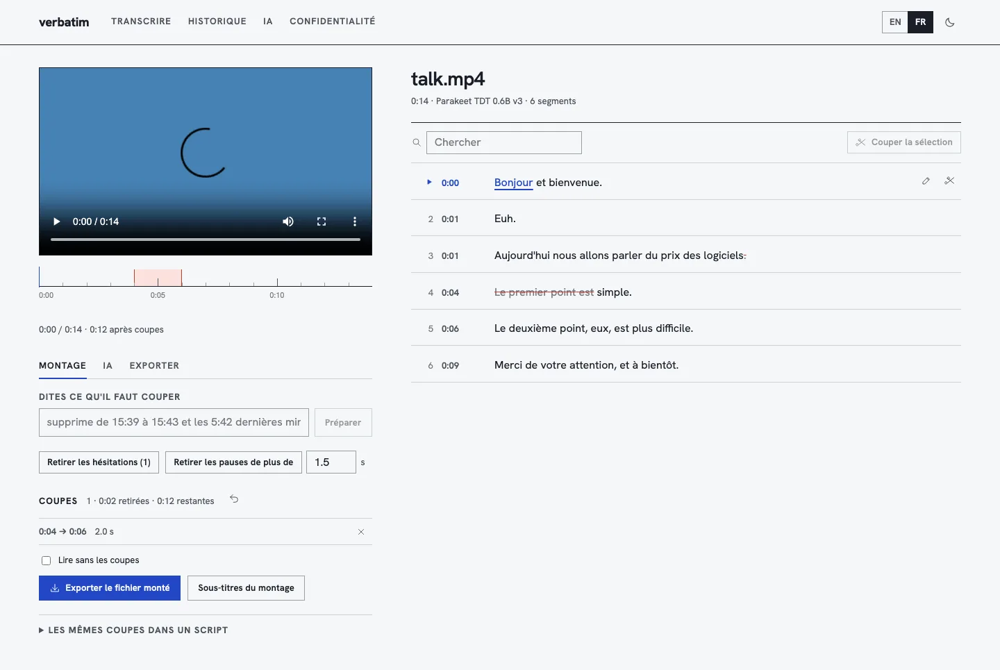

# verbatim

**Transcribe and edit video and audio on your own device.** Drop a file, get a transcript timed to the word, read it along the media, correct it, cut by time, by words or in plain language, and take away text, subtitles or the edited video. Nothing is uploaded.

→ [maxgfr.github.io/verbatim](https://maxgfr.github.io/verbatim/) · works offline · English and French · CLI: `brew install maxgfr/tap/verbatim`

[](https://github.com/maxgfr/verbatim/actions/workflows/ci.yml)
[](https://github.com/maxgfr/verbatim/releases)

<picture>
  <source media="(prefers-color-scheme: dark)" srcset="docs/editor-dark.webp">
  
</picture>

## Why

Transcription services want your recording on their servers, and editing a talk usually means a timeline editor and an afternoon. verbatim runs NVIDIA's Parakeet (or Whisper) in the browser tab, shows the transcript as the thing you edit, and renders the cut video on the device. The same engine ships as a command-line tool for scripts and agents.

## In the browser

1. Drop a video or audio file. The page says which model will run and what it downloads, once (Parakeet TDT 0.6B v3, about 670 MB; Whisper from 80 MB).
2. The transcript opens next to the media. The playing word is underlined; click any word to hear it. Correct a segment in place.
3. Cut: select words and press Delete, use a segment's scissors, remove hesitations or long pauses, or say it: “supprime de 15:39 à 15:43 et les 5:42 dernières minutes”. Times are read on the spot; anything else goes to your own AI model, whose plan is shown before it applies.
4. Play without the cuts, then export the edited file (MP4 or M4A, rendered with WebCodecs in the page), its subtitles, or the cut list and the matching `verbatim cut` command.

Exports: TXT (with or without times), SRT, VTT, Markdown, JSON, CSV, or all of them in a zip, in the original language or a translation.

| | |
|---|---|
| **Speech models** | Parakeet TDT 0.6B v3 (25 European languages, found by the model, exact word timings), Canary 180M Flash (EN, FR, DE, ES, smaller), Whisper base / small / large v3 turbo (WebGPU). Through [llm-connect](https://github.com/maxgfr/llm-models/tree/main/packages/llm-connect), on WebGPU or WebAssembly |
| **Editing** | Cuts by selection, by segment, by time phrase in French or English, hesitations, pauses, phrases said; undo; preview without the cuts; frame-exact render in the page |
| **Optional AI, your key** | Summary, timestamped chapters, translation of every segment, cleanup, and edits described by content (“cut the part about pricing”), with OpenAI, Anthropic, Google, Mistral, Groq, OpenRouter, xAI or a model on your machine (Ollama, LM Studio, Jan). Cloud transcription too, when you pick it |
| **History** | Transcripts, corrections and cuts stay in this browser; the media is never stored |

## On the command line

```bash
brew install maxgfr/tap/verbatim        # pulls ffmpeg

verbatim transcribe talk.mp4 -o talk.srt
verbatim transcribe talk.mp4 -f txt,vtt,md,json -o out/
verbatim cut talk.mp4 "supprime de 15:39 à 15:43 et les 5:42 dernières minutes" -o short.mp4 --dry-run
verbatim cut talk.mp4 --delete 15:39-15:43 --delete "last 5:42" --fillers --silences 1.5 -o short.mp4 --subtitles
verbatim plan talk.mp4 --fillers -o cuts.json && verbatim cut talk.mp4 --cuts cuts.json -o clean.mp4 --json
verbatim export talk.json -f vtt          # a transcript from the site or the CLI
```

The CLI runs the same Parakeet export as the site through ONNX Runtime (downloaded once, pinned by revision and SHA-256), cuts with ffmpeg (exact re-encode, or `--fast` stream copy), and reads time phrases with the same Rust engine the site loads as WebAssembly. Instructions that need a model use `ANTHROPIC_API_KEY`, `OPENAI_API_KEY` (with `--ai-model`) or `--ai ollama`; the plan is shown and confirmed before any file is written. `verbatim --help` for everything.

### Agent skill

```bash
npx skills add maxgfr/verbatim
```

Teaches Claude Code, Codex, Cursor and others to transcribe, plan cuts, show the plan, then apply it. `verbatim skill` prints the copy that matches the installed version.

## Privacy

The media is decoded and transcribed in the page, or on your machine with the CLI, and never uploaded. The only requests the site can make: the speech model from Hugging Face (once), and, only if you set one up and ask for something, your AI provider, which receives the transcript's text. The page's Content Security Policy allows nothing else, and CI fails the build if the bundle names any other host (`bun run check:network`). API keys are encrypted in the browser under a non-extractable key.

## Develop

```bash
bun install
bun run dev          # builds the Rust engine to WebAssembly, then serves http://localhost:4173/verbatim/
bun run test         # TypeScript tests (with the real WebAssembly engine)
bun run e2e          # Playwright: cut, render, export, no request elsewhere
cargo test --workspace
cargo run -p verbatim-cli -- --help
```

| Path | |
|---|---|
| `crates/edl` | The engine: cut lists, time phrases (FR/EN), fillers, silences, transcript remapping, every export format, the AI plan prompt and parser |
| `crates/wasm` | The engine for the page (wasm-bindgen) |
| `crates/cli` | `verbatim`: Parakeet (parakeet-rs, ONNX Runtime), ffmpeg, AI providers |
| `src/` | The site (React 19, Bun build, no framework CSS); the speech models run in `src/worker.ts` |
| `skills/verbatim` | The agent skill |

Releases follow Conventional Commits: CI green on `main` → semantic-release tags and publishes, the CLI is built for macOS (arm64, x64) and Linux (x64, arm64), attested and attached, and the Homebrew tap updates from the release.

## License

MIT. Parakeet TDT 0.6B v3 and Canary are NVIDIA's (CC BY 4.0); Whisper is OpenAI's (MIT); the ONNX exports are istupakov's and onnx-community's. Hanken Grotesk is under the SIL Open Font License.
